<div align="center">

<a href="https://github.com/GandharMarathe?tab=followers"></a>


</div>


### `01` About

Information Technology student from India who learns by shipping. Most of what I know came from
building something end to end: the interface, the API behind it, the model inside it, and the
config that gets it off my laptop.

- Building with **machine learning and AI**, and shipping it to the web with **React and Node**
- Currently going deeper into **deep learning and LLMs**
- Open to collaborating on AI and open-source projects

```txt
EDUCATION   B.E. Information Technology, AP Shah Institute of Technology (2024 - 2028)
EXPERIENCE  Software Engineering Intern, Advuman (Jan 2026 - Jun 2026)
FOCUS       AI, Full Stack, Linux, System Design
```


### `02` Selected work

| Project | What it is | Built with |
|---|---|---|
| [**Project KEYSTONE**](https://github.com/GandharMarathe/Project-KEYSTONE-Field-Service-Management-Platform) | Field service management platform: work orders, technician dispatch and SLA tracking, with separate portals for managers, technicians and customers. | Spring Boot, React, TypeScript, PostgreSQL, JWT, Docker |
| [**Taciturnus**](https://github.com/GandharMarathe/Taciturnus) | Real-time chat rooms with an AI assistant in the conversation: `@AI summarize`, `@AI next steps`, `@AI explain`. | Next.js, Socket.io, Express, Firestore, OpenAI API |
| [**Intrusion Detection**](https://github.com/GandharMarathe/aiml_final) | Random Forest classifier trained on CICIDS2017 to label network traffic as benign or as a type of attack. | Python, scikit-learn, pandas |
| [**Digit Neural Network**](https://github.com/GandharMarathe/digit_neural-network) | A two-layer neural network written by hand in NumPy, with forward pass and backpropagation as plain matrix operations, trained on MNIST. | Python, NumPy |
| [**APSIT Canteen**](https://github.com/GandharMarathe/MiniProject) | College canteen ordering system: students browse and order, admins manage the menu. | React, Spring Boot, MySQL |
| [**NGO Animal Rescue**](https://github.com/GandharMarathe/solutions-Project) | Solution Challenge build for reporting injured animals and routing the report to NGOs and volunteers. | Python, Django, SQL |


### `03` In progress

- **InNeed**: AI-assisted emergency response platform
- **Kaalnirnay**: OCR to calendar automation


### `04` Stack

| Area | Tools |
|---|---|
| **AI / ML** |  |
| **Frontend** |  |
| **Backend** |  |
| **Tools** |  |


### `05` Activity

<div align="center">




<picture>
  <source media="(prefers-color-scheme: dark)" srcset="https://raw.githubusercontent.com/GandharMarathe/GandharMarathe/output/snake-dark.svg">
  <source media="(prefers-color-scheme: light)" srcset="https://raw.githubusercontent.com/GandharMarathe/GandharMarathe/output/snake-light.svg">
  
</picture>

</div>


### `06` Connect

<a href="https://www.linkedin.com/in/gandhar-marathe-5b403b333"></a>
<a href="https://github.com/GandharMarathe"></a>

```python
while alive:
    build()
    learn()
    improve()
```

<div align="center">

*Good software isn't just code. It's solving the right problem.*

</div>
